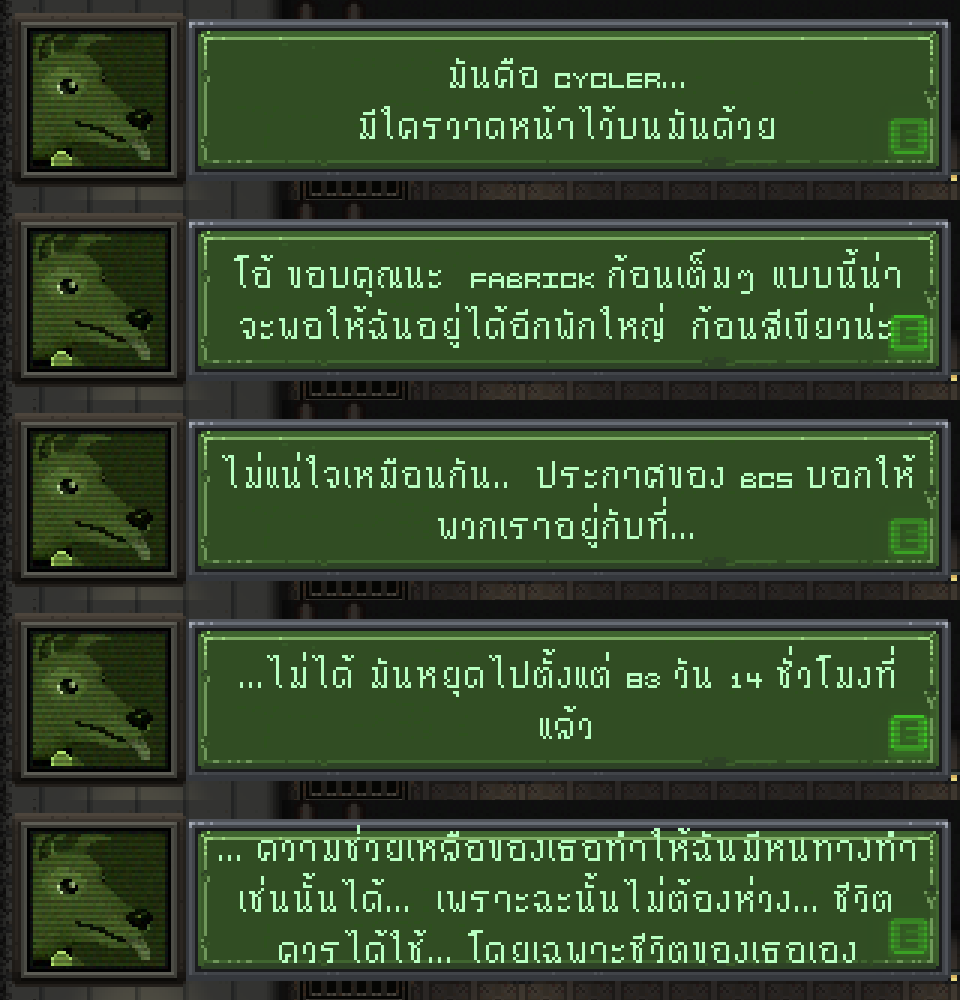
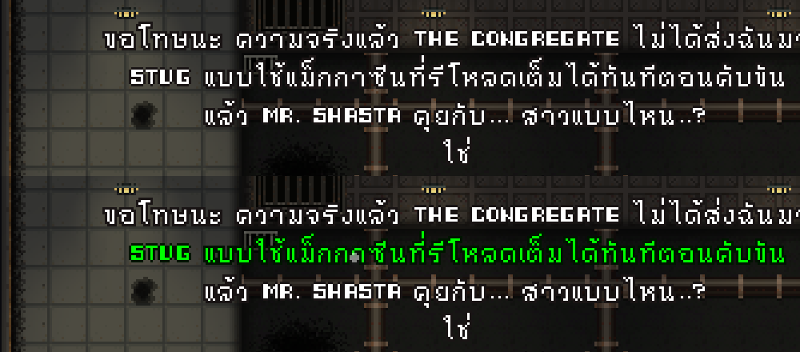
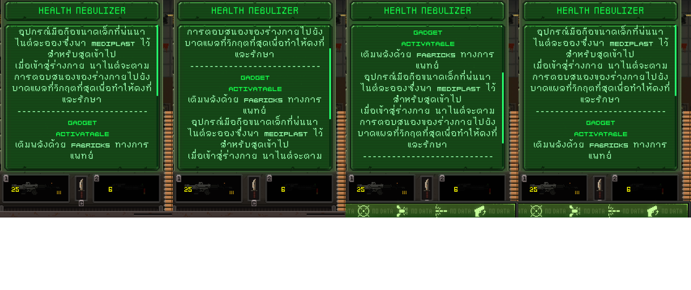

# HOPE 01 — ม็อดแปลภาษาไทย

ม็อดแปลภาษาไทย (ไม่เป็นทางการ) สำหรับเกม [HOPE 01](https://store.steampowered.com/app/4562940/) บน Steam
ใช้ฟอนต์ไทยแบบ pixel ให้เข้ากับสไตล์เกม

| บทสนทนา | ตัวเลือก | คำอธิบายไอเท็ม (เลื่อนได้) |
|---|---|---|
|  |  |  |

## แปลอะไรบ้าง

- ✅ **แปล:** บทสนทนา ตัวเลือกตอบ คำอธิบายไอเท็ม คำอธิบายอัปเกรด ป้าย และข้อความสอนเล่น (tutorial)
- ➖ **คงภาษาอังกฤษ:** ชื่อไอเท็ม ชื่อสถานที่/ห้อง ชื่อตัวละคร ชื่ออัปเกรด และเมนูพื้นฐาน
  เพื่อให้ตรงกับสิ่งที่เห็นในเกม เช่น ถ้าในบทสนทนาพูดถึง `FABRICKS` หรือ `HAB 01` ก็จะเห็นคำเดียวกันในเกม

## ความต้องการ

- Windows 10 / 11
- เกม HOPE 01 จาก Steam
- Microsoft Edge (มีมากับ Windows อยู่แล้ว ตัวติดตั้งใช้สร้างไฟล์ภาษาไทยแบบซ่อนหน้าต่าง)

## วิธีติดตั้ง

1. ไปที่หน้า [**Releases**](../../releases/latest) แล้วดาวน์โหลดไฟล์ `HOPE01-Thai-vX.X.X.zip`
2. **ปิดเกม** HOPE 01
3. แตกไฟล์ zip ไว้ที่ไหนก็ได้ เช่น Desktop หรือ Downloads
4. ดับเบิลคลิก **`Install-Thai.bat`**
   - ตัวติดตั้งจะหาโฟลเดอร์เกมจาก Steam ให้เอง ถ้าหาไม่เจอจะถามที่อยู่โฟลเดอร์ (โฟลเดอร์ที่มีไฟล์ `Hope 01.exe`)
   - รอประมาณ 10–60 วินาทีจนขึ้นข้อความ **ติดตั้งเสร็จแล้ว**
5. เปิดเกมผ่าน Steam ตามปกติ 🎮

> **ถ้า Windows ขึ้น "Windows protected your PC":** กด **More info** แล้ว **Run anyway**
> หรือก่อนแตกไฟล์ ให้คลิกขวาไฟล์ zip → **Properties** → ติ๊ก **Unblock** → OK

## วิธีถอนการติดตั้ง

- ดับเบิลคลิก **`Uninstall-Thai.bat`** เกมจะกลับเป็นภาษาอังกฤษ
- หรือใน Steam: คลิกขวาเกม → **Properties** → **Installed Files** → **Verify integrity of game files**

## เมื่อเกมอัปเดต

Steam จะเขียนทับไฟล์เกม ภาษาไทยจะหายไป **ให้ดับเบิลคลิก `Install-Thai.bat` อีกครั้ง**

- **อัปเดตเล็กน้อย:** ติดตั้งได้ตามปกติ ตัวติดตั้งสร้างไฟล์ภาษาไทยจากเกมเวอร์ชันที่คุณมีอยู่ ข้อความใหม่ที่ยังไม่มีคำแปลจะแสดงเป็นภาษาอังกฤษ
- **อัปเดตใหญ่ (เปลี่ยนตัว engine):** ตัวติดตั้งจะแจ้งว่ายังไม่รองรับ **และจะไม่แก้ไฟล์เกม** ให้รอม็อดเวอร์ชันใหม่ในหน้า Releases

## เซฟเกม

- ใช้เซฟเดิมต่อได้เลย ไม่ต้องเริ่มเกมใหม่
- เซฟที่เล่นกับม็อดแล้ว ยังเปิดได้ปกติหลังถอนม็อด

## การใช้งานในเกม

คำอธิบายไอเท็มที่ยาวเกินหน้าต่างจะมีแถบเลื่อนสีเขียวด้านขวา เลื่อนได้ด้วย:

| อุปกรณ์ | ปุ่ม |
|---|---|
| คีย์บอร์ด | ลูกศร ↑ / ↓ (ทีละบรรทัด), Page Up / Page Down (ทีละ 5 บรรทัด) |
| เมาส์ | ล้อเมาส์ (ชี้อยู่บนหน้าต่างคำอธิบาย) |
| จอย | Right stick ขึ้น / ลง |

## แก้ปัญหา

| อาการ | วิธีแก้ |
|---|---|
| ขึ้นว่าให้ปิดเกมก่อน | ปิดเกมให้สนิท (ดูใน Task Manager) แล้วรันใหม่ |
| หาโฟลเดอร์เกมไม่เจอ | ใน Steam คลิกขวาเกม → Manage → Browse local files แล้วคัดลอกที่อยู่ไปวาง |
| ไม่พบ Microsoft Edge | ติดตั้ง Microsoft Edge จาก microsoft.com แล้วรันใหม่ |
| ไฟล์เกมไม่ตรงกับที่ติดตั้งไว้ | ใช้ Steam → Verify integrity of game files แล้วรัน `Install-Thai.bat` ใหม่ |
| ข้อความบางส่วนยังเป็นภาษาอังกฤษ | เป็นชื่อเฉพาะที่ตั้งใจไม่แปล หรือเป็นข้อความที่เพิ่มมาในเกมเวอร์ชันใหม่ |

**แจ้งปัญหา / เสนอแนะคำแปล:** เปิด [Issue](../../issues) โดยแนบไฟล์ `mod\install-log.txt` (อยู่ในโฟลเดอร์ที่แตก zip) และภาพหน้าจอ

## เครดิต

- ฟอนต์ภาษาไทยแบบ pixel: **Thai_nuttatulipa** (bitsy font) โดย nuttatulipa
- เกม **HOPE 01** โดย Bending Boy Games

ม็อดนี้เป็นงานของแฟน ไม่ได้เกี่ยวข้องกับผู้พัฒนาเกมอย่างเป็นทางการ ไม่มีไฟล์ของเกมอยู่ในม็อด
ตัวติดตั้งสร้างไฟล์ภาษาไทยจากเกมที่ติดตั้งอยู่ในเครื่องของคุณเอง

---

สำหรับนักพัฒนา / ผู้ช่วยแปล: ดู [DEVELOPMENT.md](DEVELOPMENT.md) (ขั้นตอน build) และ [CODEX_REVIEW.md](CODEX_REVIEW.md) (รายละเอียดทางเทคนิค)
